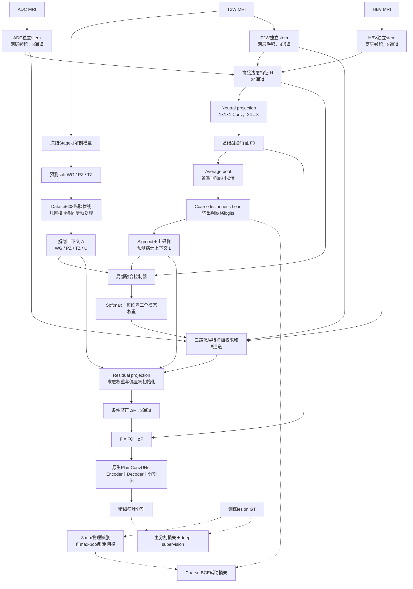

# Method — 模型结构、机制与实现追踪

工作机制：**anatomy- and lesion-conditioned local multimodal fusion**。
方法与实现边界见本文；假设见 Research_Plan；指标唯一定义见 Evaluation_Protocol；结果见 Training_Log。

**模型结构统一入口；最后结构核对日期：2026-10-10。** 本文描述当前代码实现，不表示方法已经有效。
修改模型后同步本文的图、公式、张量接口与实现索引；历史变更记录在
[Development_Log](Development_Log.md)，实际运行及状态在[Training_Log](Training_Log.md)。
不另建第二份模型说明，避免图与代码各自演化。未提交工作区不能以当前Git HEAD证明实现版本。

## 0. 阅读入口与整体结构

整体由两个模型组成：独立训练并冻结的Stage-1解剖模型，以及病灶分割模型。
Stage-1不读取lesion GT；下游推理只读取病例自身MRI预测出的soft anatomy。
病灶模型在nnU-Net骨干前增加轻量多模态前端，训练/推理框架继续复用固定nnU-Net。
浅层前端不等同于三个完整编码器；其收益与24→3投影的信息限制仍需实验验证。

| 条件 | 前端与输入机制 | 与前一条件的结构区别 |
|---|---|---|
| 原生采样参考 | 原生三通道骨干、DiceCE、原生病例选择/前景过采样 | 不含项目阳性病例平衡；与A2作采样对照 |
| A1 / A2 | 原生三通道骨干，均含项目阳性病例采样 | A1为FLCE，A2为原生DiceCE；只比较损失 |
| B | 三路独立浅层stems＋neutral projection→原生骨干 | 增加整体输入前端，无条件控制器 |
| C | B＋coarse lesionness＋soft conditioned residual | 粗定位监督与条件融合一起构成机制 |
| D | C＋预测WG/PZ/TZ/U上下文 | 解剖上下文参与控制器与残差投影 |
| E（计划） | 选定C/D后研究hard-negative sampling | 采样策略，不是额外网络分支；尚未绑定新实现 |

原生采样参考及A/B/C/D保留同一NoFFT工程修补：关闭Gaussian blur FFT benchmark，
不删除模糊增强、不改变概率或sigma。正式与短预算机制、命令与实验安排见
[Experiment_Plan](Experiment_Plan.md)；这里不维护运行状态或实验结果。

### 0.1 完整D模型图：训练监督与推理输入分开

实线为前向数据流，虚线为训练监督。Stage-1先验离线生成并进入Dataset608管线，
不是与lesion model一起端到端训练。C移除解剖上下文相关路径；B只保留stems→F0→骨干。



### 0.2 文字图：不支持Mermaid的编辑器也能阅读

```text
独立Stage-1：T2W -> 冻结解剖模型 -> soft WG/PZ/TZ
                                      -> Dataset608几何/预处理管线 -> A（仅D）

T2W -> stem -> H_T2 --+
ADC -> stem -> H_ADC -+-> concat H -> projection -> F0 ----------+
HBV -> stem -> H_HBV -+                          |             |
                                                +-> pool2     |
                                                    -> coarse logits
                                                    -> sigmoid/upsample -> L
H + L (+ A) -> controller -> softmax weights                   |
H_T2/H_ADC/H_HBV + weights -> weighted H                        |
weighted H + L (+ A) -> zero-init projection -> delta ---------+
                                                              |
                                                 F0 + delta -> nnU-Net -> segmentation

仅训练：lesion GT -> 3 mm膨胀 -> max-pool -> coarse BCE监督
        lesion GT -----------------------> 主分割/DS监督
推理：不需要lesion GT；解剖输入必须是预测先验，不能使用GT anatomy。
```

## 1. Stage-1 Soft Anatomy

复用 Dataset607 单 T2W 模型，三 sigmoid heads：WG、PZ、TZ。
位编码 reference 为 WG+2*PZ+4*TZ；soft probabilities 的通道顺序为 WG/PZ/TZ。
原生硬导出按 [1,2,4] 顺序阈值写入，后写区域覆盖前写区域；不是 argmax，也不是位编码重建。
因此独立 head 质量使用 `anatomy.validation.soft_head_metrics`，不能从硬整数图恢复 WG head。
诊断首先冻结 `>0.5`，复用原生严格大于阈值；ROI 的 `>=` 是独立既有规则。
输出独立 Dice/recall/precision/TP/FP/FN、预测/参考体积比、每病例概率分位数与硬导出重建差异。
病例分位数均值不等于 pooled voxel quantiles。诊断不写入原产物，不修改模型或数据。

Fail closed：概率浮点、有限、[0,1]、三通道、形状与物理元数据一致；reference 合法位编码；
病例重复或任一读取/几何失败即失败，不静默排除。

## 2. Predicted-Prior Input Pipeline

选用独立 `Dataset608_PICAI_PredictedAnatomy`，不做 runtime dataloader injection，不覆盖 606。
六通道顺序：T2W/ADC/HBV/P(WG)/P(PZ)/P(TZ)。先验通道 `noNorm`。
`anatomy.dataset.materialize_predicted_dataset` 只供研究者运行，链接既有 MRI/lesion label，
读取该病例 Stage-1 soft 导出，校验几何，按原网格写先验，不自行重采样。
输出目录必须全新；失败保留部分产物并明确 INCOMPLETE，不自动清理或覆盖。

`predicted_anatomy_contract` 逐病例记录 case_id、checkpoint、trainer、source split、prior_mode、
probability channel order 与 geometry，并记录 anatomy-training patient IDs。
IN_SAMPLE_PRED、OOF_PRED、HELD_OUT_PRED、EXTERNAL_PRED 不混淆；验证只接受 HELD_OUT_PRED，
且该患者不在 anatomy-training scope。当前物化器只支持同一冻结模型的 in-sample/held-out预测；
契约支持 OOF，不表示已经实现 cross-fitting 生成器。训练集已知解剖排除病例可为 HELD_OUT_PRED。

Fail closed：只接受 Dataset608，拒绝旧 606 或 ORACLE_GT；病例集合必须完整、患者无泄漏；
mode 必须与 anatomy-training scope 一致；MRI、label、prior 同网格，缺文件直接失败。
输入先验文件夹必须由受信任的冻结 Stage-1 pipeline 产生；声明的 provenance 不是密码学来源证明。

## 3. Native Preprocessing Wrapper

`nnunet.prior_preprocessor.PredictedAnatomyPreprocessor` 继承 DefaultPreprocessor。
先对前三 MRI 通道调用原生 run_case_npy，保留原生 crop/normalization/resampling/class_locations；
再把先验按相同 transpose/crop 对齐，用原生线性 probability interpolation 到相同输出网格。
这避免 soft prior 改变 MRI nonzero crop，或 cubic data interpolation 把先验变成越界概率。
强度增强只作用于 MRI；空间变换同步全部通道。无第二套训练/推理框架。

`prepare_frozen_plans` 从 605 复制架构、patch/batch/spacing/scheduler 对应配置，不重新选网络；
只加三个 noNorm 与项目 preprocessor，保留明确的源 plans 路径。
复用 MRI fingerprint 并写来源说明，不声称已对 608 做新 fingerprint 审计。
preprocessor 在进程内注册，训练/预测通过项目入口；不改第三方源码。
任何已有目标预处理目录直接拒绝，避免原生覆盖行为。真实物化/预处理仍由用户运行。

## 4. Minimal Fusion Network

实现：`multimodal/conditioned_fusion.py`，不 import legacy。

```text
T2W ─ independent shallow stem ─ H_T2 ─┐
ADC ─ independent shallow stem ─ H_ADC ├─ concat ─ 1x1 projection ─ F0 (3 channels)
HBV ─ independent shallow stem ─ H_HBV┘                         │
                                                                ├─ pool2 ─ coarse head ─ L
H_T2/H_ADC/H_HBV + L (+ soft anatomy A in D) ─ controller ─ softmax weights
weighted shallow features + L (+ A) ─ zero-init projection ─ delta (3 channels)
F0 + delta ─ unchanged native PlainConvUNet ─ fine lesion segmentation
```

### 4.1 B：先分别提取浅层特征，再进入共享骨干

以下用 `N` 表示batch size，用 `d/h/w` 表示预处理后的patch尺寸，避免与条件B/D混淆。
输入不是原始MRI网格；空间尺寸、spacing与骨干配置来自nnU-Net plans。
当前前端要求各空间尺寸为偶数且至少为2，B也执行该输入检查。

每路stem为 `Conv3d(1→8,3³) → InstanceNorm(affine=True) → LeakyReLU →
Conv3d(8→8,3³) → InstanceNorm(affine=True) → LeakyReLU`，卷积padding=1，
不降低空间分辨率。三路参数独立，分别学习T2W、ADC、HBV的局部表达。

```text
H_i = stem_i(X_i)                       i ∈ {T2W, ADC, HBV}
H   = concat(H_T2W, H_ADC, H_HBV)        沿通道轴拼接
F0  = Conv1x1x1_24→3(H)
B输出 = native_nnUNet(F0)
```

`neutral`表示不依赖病灶/解剖条件的通路，不表示原MRI恒等映射；投影本身可学习。
B不构造coarse head、controller或residual branch，也不加coarse辅助损失。
三个完整编码器可以在多尺度上保留模态特异性，但当前方案仅在输入前端实现这种分离，
后续encoder/decoder共享。其目的为检验轻量局部融合机制，不能提前声称与三编码器等效。
24→3是兼容原生三通道骨干的接口，也可能成为信息瓶颈；浅层特征是否有用必须由对照实验回答。

### 4.2 C：在自适应融合之前预测粗病灶上下文

粗定位分支读取F0，而非读取融合后的分割输出，因此称为pre-fusion lesionness。
它不是另一个完整分割网络，也没有独立decoder。

```text
Z = Conv1x1x1_8→1(LeakyReLU(Conv3x3x3_3→8(AvgPool2(F0))))
L = TrilinearUpsample(sigmoid(Z), size=(d,h,w), align_corners=False)
Q_C = [L]
```

Z是半分辨率logits，L是全patch分辨率的连续概率上下文。
控制器同时读取三路浅层特征与L，而不是仅按L分配权重。
粗目标经膨胀，L应理解为病灶附近区域的定位线索，不能作为已校准的精细病灶概率。
它不会阈值化成ROI，也不会把低概率位置从主路径中删除。

### 4.3 D：加入预测解剖上下文

```text
U   = 1 - max(P(PZ), P(TZ))             逐位置计算
A   = [P(WG), P(PZ), P(TZ), U]
Q_D = [L, A]
```

U是代码定义的uncertainty-like通道，不是熵或经过校准的不确定性；
低PZ/TZ概率也可能表示前列腺外背景，不能直接解释为模型不确定。
这些sigmoid概率不要求三通道之和为1，也不在此处强制PZ/TZ嵌套于WG。
解剖上下文进入controller和residual projection，不直接替换MRI特征。
D的Stage-1冻结，不通过病灶损失反向更新；先验来源与泄漏约束见§1–3。

### 4.4 C/D共用：soft权重与保留neutral path的残差修正

```text
g = Conv1x1x1_8→3(LeakyReLU(Conv1x1x1_(24+|Q|)→8(concat(H,Q))))
w_i = exp(g_i / T) / sum_j exp(g_j / T)  T=1.0，沿模态轴softmax
H_adaptive = sum_i w_i * H_i
ΔF = Conv1x1x1_(8+|Q|)→3(concat(H_adaptive,Q))
F  = F0 + ΔF
输出 = native_nnUNet(F)
```

每个位置有三个权重，非负且和为1；它们是特征融合系数，不是模态的因果贡献证明。
控制器和残差投影的输入都包含上下文，所以融合不只是加权平均。
残差投影权重与偏置零初始化，保证C/D自身初始化时 `F=F0`；
不保证与另一次独立训练的B拥有相同参数，也不保证F0等于MRI。
初始残差为零不代表分支永久失效；残差参数学习后，条件分支可影响分割。

| 张量/层接口 | B | C | D |
|---|---|---|---|
| 输入X | `[N,3,d,h,w]` | `[N,3,d,h,w]` | `[N,6,d,h,w]`，MRI三路＋WG/PZ/TZ |
| 每路H_i / 拼接H | 8 / 24通道，全patch网格 | 同B | 同B，仅前三通道进入stem |
| F0 | `[N,3,d,h,w]` | 同B | 同B |
| 粗logits Z | 无 | `[N,1,d/2,h/2,w/2]` | 同C |
| 上下文Q | 无 | 1通道：L | 5通道：L/WG/PZ/TZ/U |
| Controller | 无 | `25→8→3`，1³卷积 | `29→8→3`，1³卷积 |
| 权重w | 无 | `[N,3,d,h,w]` | 同C |
| H_adaptive | 无 | `[N,8,d,h,w]` | 同C |
| Residual projection | 无 | `9→3`，1³卷积 | `13→3`，1³卷积 |
| 骨干输入F | F0，3通道 | F0＋ΔF，3通道 | F0＋ΔF，3通道 |

骨干的深度、各级通道、kernel/stride等继续来自plans；不在前端重新实现encoder/decoder。
训练时原生deep supervision可返回多尺度分割list，推理时返回精细分割tensor；
coarse logits通过独立辅助通道交给训练损失，不改变原生预测输出接口。

### 4.5 固定常量与失败边界

三个 stem 各为两层 Conv3d(3³)+InstanceNorm+LeakyReLU，不共享参数。
stem_channels=8，neutral projection 24→3；coarse 分支在 F0 上先做 factor-two average pooling。
controller 两层 1³ 卷积，输出 [B,3,D,H,W]。
系数按 `weights = (controller_logits / SOFTMAX_TEMPERATURE).softmax(dim=1)` 计算：
温度在**前向里显式出现**，因此代码、run_config 与文档对该常量的语义一致；
`SOFTMAX_TEMPERATURE` 冻结为 1.0（不设 CLI 超参数、不做温度搜索），
T=1 时与直接 `logits.softmax(dim=1)` **逐值相同**（有单元测试）。
D 的 context 为 [WG,PZ,TZ,U]，U=1-max(PZ,TZ)，只是 uncertainty-like 数值通道。
residual 最后 1³ projection 零初始化，初始 delta=0。

零初始化时 controller 从分割主损失接收的梯度可为零，这是设计结果；aux head 由辅助监督学习。
测试区分初始恒等与 residual 权重非零后的梯度路径，不谎称初始所有分支均有非零梯度。
C/D 永远保留 neutral path，不以 L 或 anatomy 二值阈值硬乘输入、特征或裁剪。
D 只接收预测概率，输入必须有限且在 [0,1]；不能仅靠数值断言区分合法全零背景 patch 与硬掩膜来源，
因此来源由数据契约保证。张量 shape 不能代替物理几何检查，后者发生在物化与预处理。

热路径检查的代价已在真实 patch 形状（`[1,6,16,320,320]`，RTX 3090）上用合成张量测量：
有限性/范围的 reduce 与 bool 同步约 **0.350–0.351 ms/patch**，约为 fusion 前端（约 26.0 ms/patch）
的 **1.35%**。因此**保留**逐 patch 检查，不把 full-tensor 检查挪到仅在物化/预处理阶段：
没有证据支持用失去 fail-closed 换这点开销。边界：合成张量、单卡、非 profiler trace，
不含 backbone 前向，未测 FLOPs/显存，不构成训练吞吐声明。

## 5. Loss and Native Integration

复用 `LesionnessAuxiliaryLoss` 与物理膨胀 target，radius=3 mm、weight=0.5 保持冻结。
coarse target 从全分辨率训练 lesion GT 膨胀，再 max-pool；各向异性 spacing 来自 plans。
空 lesion 是合法阴性；非法标签/缺失 auxiliary logits/不可整除网格直接报错。
推理不需要 GT，网络只返回原生分割 tensor/DS list。

```text
A/B：Loss_total = Loss_main
C/D：Loss_total = Loss_main + 0.5 * BCEWithLogits(Z, Y_coarse)
Y_coarse = MaxPool2(PhysicalDilate(lesion_GT, radius=3 mm))
```

DiceCE家族的主损失继续使用原生Dice＋CE及其deep supervision包装；
FLCE家族保留对应显式类名，不把两种损失的结果混为同一条件。
辅助BCE监督粗logits Z，不对上采样后的L重新定义损失。
lesion GT仅用于训练监督及明确的离线评价；它不是controller的输入。
阴性病例的粗目标为全零，仍参与损失。推理只依赖MRI以及D的预测解剖先验。

新 B/C/D 分别提供 FLCE 与 DiceCE 类，方法 mixin 与显式 baseline 继承组合，不复制训练器。
同一 A/B/C/D 另有 100 epoch 短预算类（类名插入 `_100ep`，独立输出目录）：短预算类只把
`num_epochs` 在 `initialize()` 中同步为 `SHORT_BUDGET_EPOCHS`，从而让训练循环上界与
PolyLR 总周期一致；其余机制完全不变，正式 1000 epoch 类不被修改。
train loop、optimizer、PolyLR、checkpoint、validation、sliding-window/export 全部原生。
辅助 logits 暂用同进程属性通道，prototype 限单进程，禁 DDP；项目 fusion Trainer 禁 compile，
避免编译包装隐藏该属性。A1/A2 正式对照需同样冻结 compile 设置。
原生 deep supervision 开关通过 decoder 代理保留；DS 关闭不会改变 pre-fusion coarse head。

## 6. Fusion Export and Behaviour Analysis

默认不保存系数。显式 `export_fusion_weights=True` 只保留最近一次 forward 的 detached CPU patch 系数。
`fusion_weight_artifact` 是 offline hook；必须提供病例/checkpoint/geometry provenance。
不是全体积滑窗聚合器；未实现、未声称具有全体积权重导出。
`fusion_weight_statistics` 对调用方给出的区域系数子集输出 mean/std/median/IQR/entropy。
区域掩膜与物理几何由调用方核对；GT lesion 仅用于离线分析。系数不作因果解释。
`parameter_counts` 报 total/trainable/delta/delta%；未测 FLOPs/GPU memory 不写成测量结果。

## 7. Single-Variable Boundaries

| 比较 | 唯一干预 |
|---|---|
| A2 vs A1 | baseline loss，其他设置与 seed 匹配 |
| B vs A | independent shallow stems + neutral projection |
| C vs B | pre-fusion lesionness + supervised conditioned residual branch（整体机制） |
| D vs C | predicted WG/PZ/TZ/U anatomy context，MRI 主路径相同 |
| E vs best(C,D) | 困难负样本采样，最终父模型先冻结 |

C vs B 不单独识别 auxiliary supervision 与 coefficients 的各自贡献；必要时做 auxiliary-only 消融。
ROI 不混入默认 B/C/D。原 `lesion_roi/coarse_to_fine/zone_refine/hard_negative` 是 SUPPORTING，
保留原类名与输出目录，不重新命名为新 B/C/D；旧 gate 为 LEGACY 只读。
旧 E 固定继承旧 C，不代表新 E 已落实 best(C,D)。新 E 仍为计划。

## 8. Safety and Supporting Assets

修复原 B/C classmethod/instance helper 绑定；辅助采样组合修复困难负样本 loader 与 ROI 的参数/队列。
原 logits refinement 可作 supporting ablation。旧 ROI builder 的 original→preprocessed bbox 坐标链
尚待修复/验证，不能将该 supporting 流程称为就绪或加入正式模型。
不删除或覆盖数据/checkpoint；所有新训练从 scripts/train/train_nnunet.py 进入，使用独立类名。
legacy 实现与 third_party 只读。不给多个模块同时变化的结果作单变量归因。

## 9. 实现索引与持续变更跟踪

### 9.1 从模型图定位到代码

| 要查看/修改的内容 | 实现入口 | 同步核对本文 |
|---|---|---|
| Stems、neutral projection、coarse head、controller、residual、权重hook | [conditioned_fusion.py](../src/zonal_reliability_fusion/multimodal/conditioned_fusion.py) | §0图、§4公式/尺寸、§6导出边界 |
| 条件组合与Trainer分层/历史类名 | [trainers.py](../src/zonal_reliability_fusion/nnunet/trainers.py) | §0条件、§5集成、§7干预边界 |
| nnU-Net训练器集成 | [bases.py](../src/zonal_reliability_fusion/nnunet/bases.py) | §5原生机制与限制 |
| 主损失与辅助损失集成 | [losses.py](../src/zonal_reliability_fusion/nnunet/losses.py) | §5损失公式 |
| 物理膨胀/粗定位监督 | [lesionness.py](../src/zonal_reliability_fusion/lesion/lesionness.py) | §0监督路径、§5目标 |
| Dataset608物化与来源契约 | [dataset.py](../src/zonal_reliability_fusion/anatomy/dataset.py) | §1–2输入来源/泄漏边界 |
| MRI与prior同步预处理 | [prior_preprocessor.py](../src/zonal_reliability_fusion/nnunet/prior_preprocessor.py) | §3几何/通道语义 |
| 增强及NoFFT修补 | [augmentation.py](../src/zonal_reliability_fusion/nnunet/augmentation.py) | §0公平比较、§3同步增强 |
| 项目阳性病例采样 | [positive_sampling.py](../src/zonal_reliability_fusion/sampling/positive_sampling.py) | §0参考条件与A/B/C/D区别 |

当前结构常量为stem宽度8、softmax温度1.0、coarse pool factor 2、
辅助目标半径3 mm、辅助损失权重0.5，残差末层零初始化；以代码中的实际定义为准。
patch/batch/spacing与骨干结构从plans读取，不另立大配置文件。
Trainer分层唯一真源仍是`trainers.py`中的注册表，本表仅定位实现。

### 9.2 修改后如何保持说明可追溯

本文只保留**当前结构**；每次实质性模型修改，在同一次改动中更新对应图、公式、
通道/网格接口、固定常量、fail-closed边界与实现索引，并更新顶部结构核对日期。
不能只改模块名称而留下旧箭头或旧尺寸，也不能用计划中的模块描述当前实现。

在[Development_Log](Development_Log.md)追加真实变更记录：修改前后行为、研究理由、
受影响代码/Trainer、兼容性、实际执行的检查及尚未验证的边界。
本文与代码通过Git diff核对；提交后用实际commit追溯。未提交改动必须显式标记，
不能仅用HEAD作为运行时源码版本证明。不会因为更新本文而自动提交、推送或启动训练。

改变输入契约、网络结构或研究条件时保留历史Trainer与checkpoint解析能力，
需要独立条件则使用明确类名及独立输出目录，不覆盖历史产物。
实际训练/验证的命令、源码版本证据、checkpoint、plans/split与先验来源记录到
[Training_Log](Training_Log.md)及获授权的对应实验文档；运行状态只维护Training_Log的状态表。
研究假设/实验安排/评价协议分别同步到其已有责任文档，结果结论只能依据已有证据写入Findings。

跟踪覆盖每次获授权的修改与用户返回的运行产物核查，不表示后台自动监控或自动运行实验。
