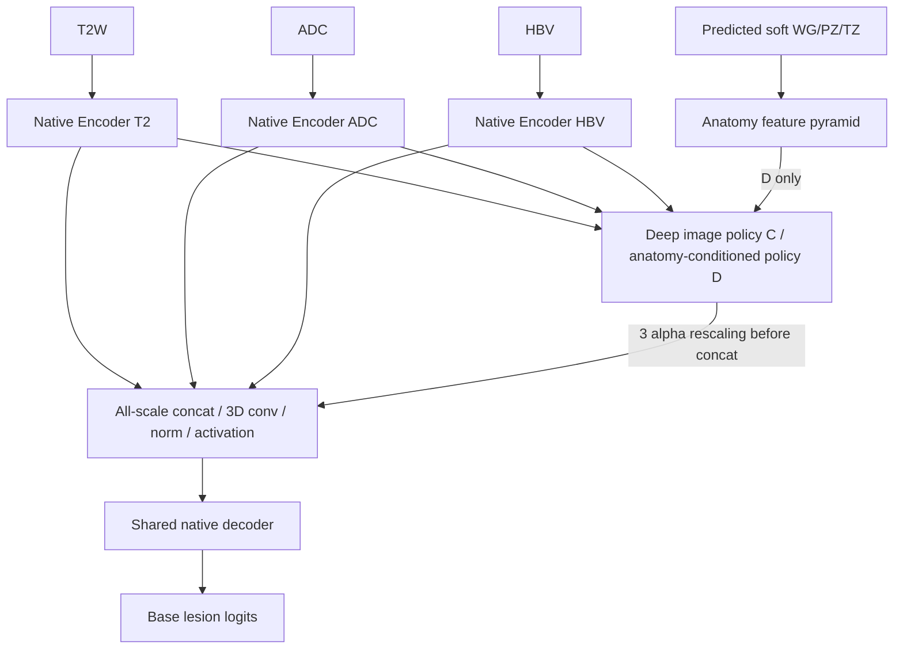

# VERSION=V2 — Architecture

机制与 fail-closed 契约唯一实现说明见 [Method](Method.md)。本文负责结构与 tensor/data-flow 对照，
实验矩阵与运行预算见 [Experiment Plan](Experiment_Plan.md)。

## 1. ASCII architecture

当前concat家族（B无policy，C为image-only policy，D为anatomy-conditioned policy）：

```text
T2W -> native Encoder_T2  -> F_T2[0..L] ---+
ADC -> native Encoder_ADC -> F_ADC[0..L] --+--> all scales: concat -> Conv3d(3C,C,3)
HBV -> native Encoder_HBV -> F_HBV[0..L] --+                   -> norm -> activation
                                         ^                         -> fused skips
                   C/D deep scales: 3*alpha_m*F_m                          |
predicted soft WG/PZ/TZ -> anatomy pyramid -> D policy                    v
                                                               native shared decoder
                                                                    -> lesion logits
```

旧均值/直接加权与coarse/refiner实现保留原类；当前三组均不启用coarse/refiner/schedule。

## 2. Mermaid architecture



## 3. Tensor contracts and actual plans

Input `[B,3,Z,Y,X]` for image-only arms；`[B,6,Z,Y,X]` for anatomy arms。
前三通道 T2W/ADC/HBV，后三 soft WG/PZ/TZ。当前 Dataset605/608 的架构相同：

| Zero-based stage | Channels per encoder | Grid at plans patch [16,320,320] | Fusion policy |
|---|---:|---|---|
| 0 | 32 | 16×320×320 | concat投影 |
| 1 | 64 | 16×160×160 | concat投影 |
| 2 | 128 | 16×80×80 | concat投影 |
| 3 | 256 | 8×40×40 | concat投影 |
| 4 | 320 | 4×20×20 | concat投影；C/D先soft policy调节 |
| 5 | 320 | 4×10×10 | concat投影；C/D先soft policy调节 |
| 6 / bottleneck | 320 | 4×5×5 | concat投影；C/D先soft policy调节 |

每个 `F_m^s` 和 fused skip 为 `[B,C_s,Z_s,Y_s,X_s]`，anatomy context 为 `[B,8,Z_s,Y_s,X_s]`，
weights 为 `[B,3,Z_s,Y_s,X_s]`（仅C/D深层），base/final `[B,2,16,320,320]`。
concat家族无coarse logits；旧候选coarse头形状仍为`[B,1,4,5,5]`。
native DS 从最大分辨率到较小尺度共6个输出；最低 bottleneck 不作为 decoder DS 输出。
small synthetic plans 为3层；真实 plans synthetic patch [16,64,64] 只验证形状与梯度，
full plans patch/batch 显存须用户另跑 helper。

## 4. Variant data-flow differences

当前B/C/D为独立ConcatFusion/ConcatAdaptiveFusion/ConcatAnatomyFusion类，三者相同全尺度投影，
仅深层policy及其anatomy输入逐次增加；CLI、预算及矩阵见Experiment Plan。
以下原类仍保留原义、不作为当前concat对照：

V2-A 直接三MRI输入一个原生 encoder；V2-B 三独立 encoder 所有尺度 mean；
V2-C selected scales 加 image-only controller；V2-D controller 再读 anatomy pyramid；
V2-E 增加 bottleneck coarse evidence/aux loss；V2-F 增加末端 probability-localized residual；
V2-F-SCHED 与 F 同架构，仅按训练阶段启用。完整 variant 表只在 Experiment Plan 维护。

## 5. Training and inference

训练输出保留原生 DS list，coarse loss 从 network side channel 读 logits 与 training GT；
推理关闭 DS，返回普通 logits tensor，不读 GT、不返回 tuple/dict。
原生 mirror/滑窗/prediction export 保持；input priors 与MRI同步 crop/pad/空间变换。
coarse evidence 在 F 推理中仍计算；coarse-only E 推理仍计算该轻量 head，但输出只含 segmentation。
只有最高分辨率最终 logits 修正，其他DS头不重复 refiner。

## 6. Predicted anatomy

soft overlapping heads，不是第四 MRI，不要求互斥归一化；anatomy provenance 独立于 tensor 合法性。
输入 order、range、finite、noNorm、predicted source、checkpoint、split、geometry 与训练范围均 fail closed。
608 与历史606隔离；formal Trainer 拒绝 GT anatomy。详见 Method §3。

## 7. Fusion formula

`A_s=projection_s(resize(P_WG,P_PZ,P_TZ))`；
`z_s=G_s(concat(F_T2,F_ADC,F_HBV,A_s))`；
`alpha_s=softmax(z_s,dim=modality)`；当前C/D为`F_fused=Phi_s(concat(3*alpha_m*F_m))`。
B以及浅层直接`Phi_s(concat(F_m))`，Phi保持3C→C输出通道。实现/初始化边界只见Method §2.1。
每 voxel softmax 和为1，不把 weights 当医学因果重要性。

## 8. Coarse head

§8–10为原候选扩展，不属于当前concat家族。

fused bottleneck 的 binary 1×1 logit head；max-pooled lesion GT 仅训练 loss 用，
Dice+BCE 以固定权重0.5叠加 main；不是 text similarity/alignment head。

## 9. Local refiner

`candidate=stopgrad(max(P_base,up(P_coarse)))`，输入MRI浅层 skip features、base、anatomy、candidate，
局部卷积得到 Δlogits，`q_final=q_base+candidate*Δlogits`。
zero-init 末层保证初始 equivalence；soft locality 不 hard crop，不引入额外 uncertainty 策略。

## 10. Phase schedule

1000ep scheduled：P1 [0,200) mean/main；P2 [200,600) anatomy/coarse；P3 [600,1000) refine。
无分组LR/冻结；resume由current_epoch重算。推理类重建默认full，正式比较用final。
Method §6 与 Experiment Plan §6 记录相同精确边界。

## 11. Formal V1 vs V2 comparison

| 维度 | V1 — FROZEN | V2 — ACTIVE MAINLINE |
|---|---|---|
| Representation | shallow independent stems → 24→3 neutral projection | full modality-specific hierarchical encoders |
| Backbone | 单个 unchanged shared encoder PlainConvUNet | multi-scale fused skips → shared native decoder |
| Anatomy | input/front-end conditioning | deeper hierarchical fusion-policy conditioning；refiner context仅原候选 |
| Lesion evidence | pre-backbone shallow controller context | 当前concat家族不加coarse监督；原候选实现保留 |
| Residual | backbone 前的 conditioned residual | 当前concat家族不加refiner；原候选zero-init residual保留 |
| Research status | 历史研究/复现/消融参考，不扩张 | 唯一活跃研究线，效果尚未验证 |

LEGACY 是更早 gate / historical lines，既不是 V1，也不是 V2。

## 12. Align then Refine boundary

[作者论文](https://arxiv.org/abs/2604.18713) 与只读源码参考提供 multi-encoder→decoder、
bottleneck auxiliary supervision、late controlled update、phase scheduling 的设计动机。
当前项目侧FusionBlock参考concat/3×3×3 conv/norm/activation结构，并用原生encoder/decoder组合。
源码中的residual encoder/decoder、TopK/Tversky、增加的验证采样、
文本预训练、动态aux schedule、text-refiner gamma/tau 均未移植到项目 runtime。

Align then Refine：**Text → semantic alignment / text refinement**。
当前V2：**Anatomy → concat前的融合调节policy**；Lesion evidence→refinement仅保留候选。
项目选用 plans-native PlainConvEncoder/UNetDecoder 与独立小控制模块；
不是把 Text 机械替换为 Anatomy，也不是复现作者结果。参考 checkout 与 runtime fork 严格隔离。
